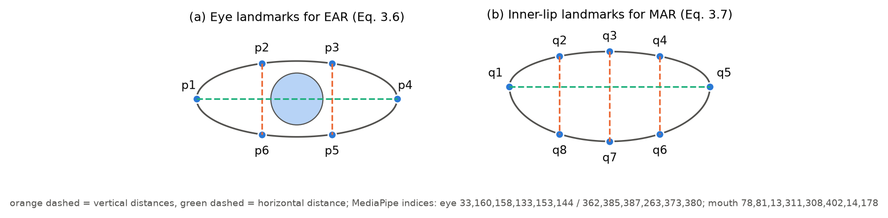
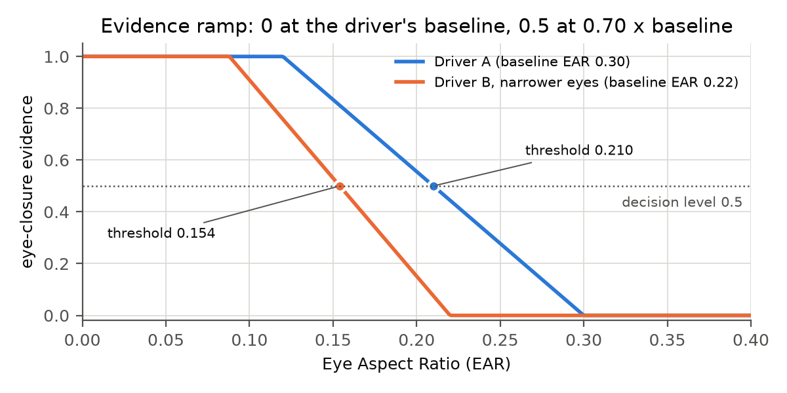
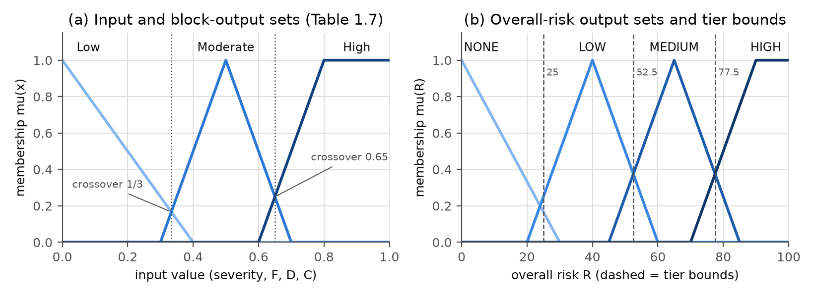
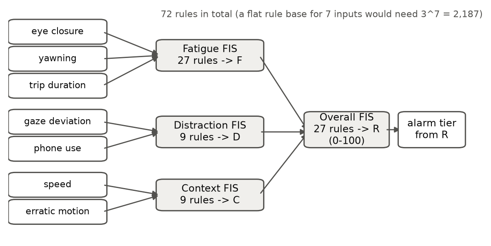

# Chapter 3 THEORETICAL CONSIDERATIONS

This chapter presents the theories, models and equations on which the detection model of the AI-based adaptive driver-monitoring system is built. The detection model turns each camera frame from the ESP32-CAM into an alarm decision through five stages: (1) AI-based image detection, (2) visual feature extraction, (3) threshold-based classification, (4) severity grading, and (5) overall driver-risk calculation. The chapter follows that order. It first draws the distinction between the learned (AI) parts of the model and the rule-based parts, and closes with the metrics used to evaluate them. The theory behind the ESP32 hardware, GNSS/IMU positioning and the Firebase back end is covered by the respective subsystem sections.

---

## 3.1 Learned Perception and Rule-Based Interpretation

An artificial-intelligence (AI) component, in the sense used in this study, is a model whose behaviour is *learned from labelled examples* rather than written by hand. A convolutional neural network, for instance, is not told what a mobile phone looks like; its millions of parameters are adjusted during training until its outputs agree with human labels (LeCun et al., 2015). A rule-based component, in contrast, applies relationships that a designer states explicitly, such as "the eyes are closed when the Eye Aspect Ratio falls below 70 % of the driver's normal value."

The two kinds of component solve different problems. Recognising a face, locating 478 points on it, or finding a phone in a cluttered cabin image are *perception* problems. They are hard to describe with explicit rules, but learned models solve them well. Deciding whether a two-second glance is a mirror check or a dangerous distraction, or whether a closed eye is a blink or a microsleep, is an *interpretation* problem. It depends on time, on the individual driver and on the driving context, and it must be transparent enough to be tuned, audited and explained. Several of the reviewed systems combine the two. Magán et al. (2022) fed features extracted by deep networks into a fuzzy-logic stage and obtained fewer false positives than an end-to-end network. Ersoy et al. (2026) combined CNN classification with personalised thresholds.

The proposed detection model follows the same principle. Neural networks perform perception (Stage 1). Deterministic computations and rules interpret what the networks perceive (Stages 2 to 5). The thresholds are therefore not the "intelligence" of the system. They are the calibrated decision boundaries applied to measurements produced by AI models. TABLE 3.1 lists every component and its type.

TABLE 3.1 LEARNED AND RULE-BASED COMPONENTS OF THE DETECTION MODEL

| Stage | Component | Type | Learns from / defined by | Output |
|---|---|---|---|---|
| 1 | Face detector (BlazeFace) | Learned (CNN) | Large face-image datasets (Google, pre-trained) | Face bounding box |
| 1 | Face-mesh network | Learned (CNN) | Annotated face meshes (pre-trained) | 478 3-D facial landmarks |
| 1 | Blendshape network | Learned (neural network) | Expression data (pre-trained) | 52 expression coefficients, e.g. `eyeBlinkLeft`, `jawOpen` |
| 1 | YOLO detector (YOLOv8 / YOLO11 / YOLO26) | Learned (CNN) | COCO; optionally fine-tuned on driver images | Phone bounding boxes and confidences |
| 1 | Eye-state classifier (optional) | Learned (CNN) | MRL Eye Dataset | Probability that the eyes are closed |
| 2 | EAR, MAR, head pose, phone-near-driver | Deterministic geometry | Equations 3.9 to 3.13 | Numeric features per frame |
| 3 | Calibration, evidence fusion, persistence | Rules + statistics | Per-driver baseline, stated thresholds | Per-frame states and behaviour events |
| 4 | Severity grading | Rules | Anchor tables | Severity score and level per behaviour |
| 5 | Mamdani fuzzy inference + alert manager | Fuzzy rules | Rule bases, membership functions | Risk score R and alarm tier |

The model therefore has more learned components than the description in Section 1.7.8 suggests. There, the YOLO detector is described as "the only trained model in the pipeline." The facial measurements used for drowsiness, yawning and gaze are also produced by neural networks: EAR and MAR are computed from landmarks that a CNN predicts. The blendshape coefficients add a second, directly learned estimate of eye closure and mouth opening.

---

## 3.2 Image Formation and the Pinhole Camera Model

A camera maps a three-dimensional point $\mathbf{X} = (X, Y, Z)^\top$ in the world to a pixel $(u, v)$. Under the pinhole model (Hartley & Zisserman, 2004), this mapping is

$$
s \begin{bmatrix} u \\ v \\ 1 \end{bmatrix} = \mathbf{K}\,[\,\mathbf{R} \mid \mathbf{t}\,] \begin{bmatrix} X \\ Y \\ Z \\ 1 \end{bmatrix},
\qquad
\mathbf{K} = \begin{bmatrix} f_x & 0 & c_x \\ 0 & f_y & c_y \\ 0 & 0 & 1 \end{bmatrix}
\tag{3.1}
$$

where $\mathbf{K}$ holds the intrinsic parameters (focal lengths $f_x, f_y$ in pixels and principal point $c_x, c_y$), $\mathbf{R}$ and $\mathbf{t}$ are the rotation and translation of the object relative to the camera, and $s$ is a scale factor. Head-pose estimation (Section 3.7.3) inverts this relationship. It recovers $\mathbf{R}$, the orientation of the driver's head, from the pixel positions of known facial points.

---

## 3.3 Convolutional Neural Networks

A convolutional neural network (CNN) processes an image with layers of small learnable filters. A convolution layer computes each output value as a weighted sum over a local neighbourhood of the input:

$$
y_{i,j,c'} = \sigma\!\left( b_{c'} + \sum_{c}\sum_{m=-k}^{k}\sum_{n=-k}^{k} w_{m,n,c,c'}\; x_{i+m,\,j+n,\,c} \right)
\tag{3.2}
$$

where $x$ is the input feature map, $w$ and $b$ are the learned weights and biases, $c$ and $c'$ index input and output channels, and $\sigma$ is a non-linear activation. Stacking such layers yields a hierarchy of features, from edges and textures in early layers to object parts and whole objects in deeper layers (LeCun et al., 2015). Training adjusts all weights by gradient descent to minimise a loss function that measures disagreement with labelled examples. Because the weights come from data, a CNN can recognise patterns such as faces or phones under lighting, pose and appearance variations that would be impractical to describe with hand-written rules. This is also why its reliability depends on how well the training data match the deployment conditions (El-Nabi et al., 2024).

---

## 3.4 Face Detection, Face Mesh and Blendshapes

The facial measurements are produced by the MediaPipe Face Landmarker (Lugaresi et al., 2019), a bundle of three neural networks designed for real-time use on mobile devices.

1. **Face detection.** A BlazeFace detector finds the face and returns its bounding box. BlazeFace is a lightweight single-shot detector designed for sub-millisecond inference on mobile GPUs (Bazarevsky et al., 2019). Its short-range variant is intended for faces close to the camera, which matches a windshield-mounted camera facing the driver.
2. **Face mesh.** A regression CNN takes the face crop and predicts the 3-D coordinates of a dense set of facial landmarks (Kartynnik et al., 2019). An attention-based refinement adds detail around the eyes, lips and irises, giving 478 landmarks in total (Grishchenko et al., 2020). In video mode, the landmarks from one frame define the crop for the next, so the detector does not have to run on every frame.
3. **Blendshapes.** A third network converts the landmarks into 52 blendshape coefficients in $[0, 1]$. Each one scores the intensity of a facial action, for example `eyeBlinkLeft`, `eyeBlinkRight` and `jawOpen`.

The landmarks feed the geometric features of Section 3.7. The blendshape coefficients are a second, *learned* measurement of the same facial actions. Because they are produced by a network trained on many faces, they may respond differently from the geometric ratios to head pose and to individual eye or mouth shapes. Whether they are more reliable for the target drivers is an empirical question that the ablation study of Chapter 4 is designed to answer.

---

## 3.5 Object Detection with YOLO

### 3.5.1 Single-Stage Detection

An object detector returns a set of bounding boxes, each with a class label and a confidence score. "You Only Look Once" (YOLO) detectors predict all boxes in a single forward pass of one CNN, which makes them fast enough for real-time use (Redmon et al., 2016). The overlap between a predicted box $B_p$ and a ground-truth box $B_g$ is measured by the Intersection over Union:

$$
\mathrm{IoU}(B_p, B_g) = \frac{|B_p \cap B_g|}{|B_p \cup B_g|}
\tag{3.3}
$$

Conventional YOLO heads predict several overlapping boxes for the same object. **Non-maximum suppression (NMS)** then keeps the highest-scoring box and discards the others whose IoU with it exceeds a threshold (0.5 in this study). NMS is a post-processing step outside the network, so its cost does not appear in the network's inference time. It must still be counted when latency on a phone is measured.

### 3.5.2 YOLOv8

YOLOv8 (Jocher et al., 2023) is an anchor-free detector. Its head predicts box distances directly from each feature-map location, with separate (decoupled) branches for classification and box regression. The backbone uses C2f blocks. Box edges are represented as discrete probability distributions refined by Distribution Focal Loss (DFL; Li et al., 2020), and the outputs require NMS. The nano variant `yolov8n` is the baseline named in Section 1.7.8.

### 3.5.3 YOLO11

YOLO11 (Jocher & Qiu, 2024) keeps the anchor-free, NMS-based design of YOLOv8 but revises the building blocks. It uses C3k2 blocks in place of C2f and adds a C2PSA block with spatial attention. The nano model is smaller than YOLOv8n: 2.62 million parameters and 6.7 GFLOPs at 640 × 640, against 3.16 million and 8.9 GFLOPs, as measured in this study with the Ultralytics profiler.

### 3.5.4 YOLO26

YOLO26 (Ultralytics, 2026) is designed for edge and low-power deployment. Its two most relevant changes for a phone are:

* **End-to-end, NMS-free prediction.** Like YOLOv10 (Wang et al., 2024), the head is trained to output one box per object (one-to-one assignment), so the NMS step of Section 3.5.1 is not needed at inference time. The model definition used in this study declares `end2end: True`.
* **DFL removal.** Box regression predicts coordinates directly (`reg_max = 1` in the model definition) instead of distributions, which simplifies the exported graph for mobile runtimes.

The Ultralytics documentation also describes new training-time components (the ProgLoss and STAL loss/assignment strategies for small objects and the MuSGD optimiser) and reports faster CPU inference than earlier generations. These are vendor claims. This study does not assume them; it measures them under identical conditions (Chapter 4). The nano model measures 2.57 million parameters and 6.2 GFLOPs at 640 × 640.

*Naming note.* The adviser's "YOLOv11" and "YOLOv26" are published by Ultralytics as **YOLO11** and **YOLO26**. The "v" was dropped after YOLOv8, so this document uses the official names.

### 3.5.5 Transfer Learning and Domain Shift

All three detectors are distributed with weights pre-trained on COCO (Lin et al., 2014), which contains a "cell phone" class. Fine-tuning continues training from these weights on driver-cabin images so that the detector adapts to the new *domain*: camera angle, lighting, hands and partial occlusion. The State Farm and AUC distracted-driver datasets are captured from the passenger side, while the ESP32-CAM views the driver from the windshield. This difference in viewpoint is a domain shift that can lower accuracy. For that reason, images from the prototype's own camera are needed for the final evaluation (Chapter 4).

### 3.5.6 Deploying Detectors on Mobile Devices

A trained network is exported to a mobile runtime such as TensorFlow Lite (LiteRT), NCNN or ONNX Runtime. Two properties matter most on a phone.

* **Numeric precision.** Weights and activations can be stored as 32-bit floats (FP32), 16-bit floats (FP16) or 8-bit integers (INT8). INT8 quantisation maps a real value $x$ to an integer $q$ with a scale $S$ and zero-point $Z$ (Jacob et al., 2018):

$$
q = \mathrm{round}\!\left(\frac{x}{S}\right) + Z, \qquad x \approx S\,(q - Z)
\tag{3.4}
$$

  This reduces model size by about four times compared with FP32 and enables fast integer kernels, usually at a small cost in accuracy. The actual cost must be measured.
* **Computational cost versus latency.** Parameter count and floating-point operations (FLOPs) describe the size and arithmetic of a model. However, measured latency also depends on memory traffic, on whether every operator is supported by the phone's accelerator (GPU/NPU delegate), and on post-processing such as NMS. A model with fewer FLOPs is therefore not guaranteed to run faster on a given phone, which is why the comparison in Chapter 4 measures latency directly.

---

## 3.6 Eye-State Image Classification

An image classifier assigns one label to a whole image. For eye state, a small CNN receives a crop of one eye and outputs class probabilities through the softmax function:

$$
P(\text{class } k \mid \text{crop}) = \frac{e^{z_k}}{\sum_{j} e^{z_j}}
\tag{3.5}
$$

where $z_k$ are the network's output scores. The MRL Eye Dataset (Fusek, 2018) contains tens of thousands of infrared eye crops from many subjects, each labelled open or closed, with and without glasses and under varied reflections. The dataset contains eye crops only, not full faces, so the landmark-based EAR cannot be computed on it. It is therefore suitable for *training* an eye-state classifier but not for validating EAR, as proposed in Section 1.7.8. The detection model includes an optional eye-state classifier of this kind (a YOLO classification network). When enabled, its probability of "closed" becomes a third learned source of eye-closure evidence.

---

## 3.7 Geometric Facial Features

### 3.7.1 Eye Aspect Ratio

The Eye Aspect Ratio (Soukupová & Čech, 2016) relates the vertical opening of the eye to its width, using six landmarks $p_1, \dots, p_6$ (Figure 3.1a):

$$
\mathrm{EAR} = \frac{\lVert p_2 - p_6 \rVert + \lVert p_3 - p_5 \rVert}{2\,\lVert p_1 - p_4 \rVert}
\tag{3.6}
$$

Here $p_1$ and $p_4$ are the eye corners, $p_2, p_3$ lie on the upper lid and $p_6, p_5$ on the lower lid. The ratio does not change with the size of the face in the image. It stays roughly constant while the eye is open (about 0.25–0.35 for MediaPipe landmarks; 0.28–0.30 was measured on the test face in this study) and falls toward zero as the lids close. The EAR of each eye is computed separately and the two values are averaged. EAR has two known weaknesses. Its open-eye value differs from person to person (Albadawi et al., 2023; Dewi et al., 2022). It also drops when the head is lowered, because the upper lids then cover more of the eye. The first weakness motivates per-driver calibration (Section 3.9). The second is handled by suspending eye-state judgement while the head is turned away (Chapter 4).

### 3.7.2 Mouth Aspect Ratio

The Mouth Aspect Ratio uses eight inner-lip landmarks $q_1, \dots, q_8$. Here $q_1$ and $q_5$ are the inner mouth corners, $q_2, q_3, q_4$ lie on the upper inner lip and $q_8, q_7, q_6$ on the lower inner lip:

$$
\mathrm{MAR} = \frac{\lVert q_2 - q_8 \rVert + \lVert q_3 - q_7 \rVert + \lVert q_4 - q_6 \rVert}{3\,\lVert q_1 - q_5 \rVert}
\tag{3.7}
$$

MAR is close to zero with the mouth closed (0.007 on the test face), moderate during speech, and large during a yawn.

*Figure 3.1 (a) The six eye landmarks of Equation 3.6 and (b) the eight inner-lip landmarks of Equation 3.7, with the MediaPipe face-mesh indices used by the implementation.*

### 3.7.3 Head Pose by Perspective-n-Point

The Perspective-n-Point (PnP) problem finds the rotation $\mathbf{R}$ and translation $\mathbf{t}$ that best project $n$ known 3-D model points $\mathbf{X}_i$ onto their observed 2-D positions $\mathbf{x}_i$. It does so by minimising the reprojection error:

$$
(\mathbf{R}^{\ast}, \mathbf{t}^{\ast}) = \arg\min_{\mathbf{R},\,\mathbf{t}} \sum_{i=1}^{n} \big\lVert \mathbf{x}_i - \pi\!\left(\mathbf{K}(\mathbf{R}\mathbf{X}_i + \mathbf{t})\right) \big\rVert^2
\tag{3.8}
$$

where $\pi$ divides by the third coordinate as in Equation 3.1. The detection model uses six points: the nose tip, the chin, the two outer eye corners and the two mouth corners. It solves Equation 3.8 with OpenCV's `solvePnP` using the SQPnP algorithm, which finds the globally optimal solution quickly and consistently (Terzakis & Lourakis, 2020). The rotation matrix is converted into three angles: **yaw** (turning left or right), **pitch** (looking up or down) and **roll** (tilting). Head pose is used as a practical substitute for eye-gaze tracking, which becomes unreliable at low resolution, with sunglasses or under changing illumination (Zhang & Abdel-Aty, 2022). The absolute angles carry a bias because of the generic face model, the approximate focal length and the off-axis camera mounting. This bias is removed by measuring deviations from each driver's calibrated forward pose.

---

## 3.8 Evidence Normalisation and Fusion

Different signals describe the same facial state on different scales. EAR *decreases* toward about 0.2 when the eyes close, the `eyeBlink` blendshape *increases* toward 1, and an eye-state classifier outputs a probability. To combine them, each signal $x$ is mapped to an **evidence score** with a linear ramp that is anchored to the driver's own baseline $b$ and threshold $\tau$ (Figure 3.2):

$$
e(x) = \operatorname{clip}\!\left( \frac{1}{2}\cdot\frac{x - b}{\tau - b},\; 0,\; 1 \right)
\tag{3.9}
$$

The evidence is 0 at the driver's neutral value, exactly 0.5 at the per-driver threshold, and 1 at twice that distance. The same formula works whether the signal rises or falls toward its threshold. Evidence from $m$ available sources is fused by a weighted mean:

$$
E = \frac{\sum_{s=1}^{m} w_s\, e_s}{\sum_{s=1}^{m} w_s}
\tag{3.10}
$$

Sources that are missing on a frame are left out and the remaining weights are renormalised. Examples are a face too small for the eye classifier, or a model that is not installed. This is *late* (decision-level) fusion. Each source is interpreted on a common scale before combination, so a source can be added, removed or re-weighted without changing the others. Setting a weight to zero yields the "geometric-only" and "learned-only" variants used in the ablation study. A state is declared ON when $E \ge 0.5$. Because every source is scaled so that 0.5 means "at the threshold," the decision rule has the same meaning for every combination of sources.

*Figure 3.2 Eye-closure evidence as a function of EAR for two drivers. The per-driver threshold (dot) lies at 0.70 × the driver's baseline, so a driver with narrower eyes receives a proportionally lower threshold.*

---

## 3.9 Adaptive Per-Driver Thresholds

Fixed thresholds generalise poorly across people (Dewi et al., 2022; Lamba et al., 2025). Personalised thresholds improved accuracy by about 2–3 % in Ersoy et al. (2026). The detection model therefore expresses each threshold relative to a baseline measured from the driver.

**Baseline estimation.** During a short calibration window, the driver looks ahead with a relaxed face. The baseline of each signal is the *median* of its values in the window. The median is robust to the occasional blink or glance, because up to half the samples can be outliers without moving it. Head steadiness is checked with the inter-quartile range, scaled to be comparable with a standard deviation:

$$
\hat{\sigma} = \frac{Q_3 - Q_1}{1.349}
\tag{3.11}
$$

The more familiar median absolute deviation (MAD) is not used here. MAD collapses to zero when the head alternates between two positions, which would wrongly accept an unsteady calibration (Rousseeuw & Croux, 1993). This case was found and fixed during testing.

**Relative thresholds.** With baselines $b_{\mathrm{EAR}}$, $b_{\mathrm{MAR}}$, $b_{\mathrm{yaw}}$ and $b_{\mathrm{pitch}}$, the thresholds are $\tau_{\mathrm{EAR}} = r\,b_{\mathrm{EAR}}$ (with $r = 0.70$), $\tau_{\mathrm{MAR}} = b_{\mathrm{MAR}} + \Delta_{\mathrm{MAR}}$, and head-turn limits of $\pm\Delta_{\mathrm{yaw}}$ and $\Delta_{\mathrm{pitch}}$ around the driver's own forward pose.

**Online adaptation.** Conditions drift within a trip, for example through changing light or posture. The baseline is therefore updated with an exponential moving average. The update runs only on frames in which the driver is confidently alert and facing forward, and it is suspended whenever a drowsy or distracted state is present:

$$
b_k = b_{k-1} + \alpha_k\,(x_k - b_{k-1}), \qquad \alpha_k = 1 - e^{-\Delta t_k / T}
\tag{3.12}
$$

Here $\Delta t_k$ is the time since the previous update and $T$ is the time constant (120 s), so the adaptation rate does not depend on the frame rate. The adapted baseline is also clamped to a band around the calibrated value, so impaired periods cannot pull it far. This mechanism is statistical rather than learned, consistent with Section 1.7.9.

---

## 3.10 Temporal Characteristics of Drowsiness and Distraction

A single frame cannot tell a blink from a microsleep, speech from a yawn, or a mirror check from a distraction. The difference lies in *duration* and *frequency*.

### 3.10.1 Blinks and Prolonged Eye Closures

Spontaneous blinks are brief, typically a few hundred milliseconds. Blink duration increases with drowsiness (Caffier et al., 2003). Closures clearly longer than a blink are therefore a sign of drowsiness. For example, Wu and Chang (2022) warn when the eyes stay closed for more than 0.5 s.

### 3.10.2 PERCLOS

PERCLOS is the percentage of time within a window during which the eyes are closed. Wierwille et al. (1994) and Dinges and Grace (1998) found it to be one of the most reliable video-based indicators of reduced alertness. With frames at irregular times $t_k$ and closed-eye indicator $c_k \in \{0, 1\}$, the time-weighted estimate over a window $W$ is

$$
\mathrm{PERCLOS} = \frac{\sum_{t_k \in W} c_k\,\Delta t_k}{\sum_{t_k \in W} \Delta t_k}
\tag{3.13}
$$

Weighting by $\Delta t_k$ keeps the estimate correct when the frame rate varies, as it does over Wi-Fi. Commonly cited interpretations treat PERCLOS above about 15 % as drowsy and roughly 7.5–15 % as questionable (Dinges & Grace, 1998).

### 3.10.3 Yawning versus Speech

Speech opens the mouth repeatedly for short periods and rarely to its full extent. A yawn opens it wide and holds it open for several seconds. A minimum duration of sustained wide opening therefore separates the two. The frequency of yawns over several minutes then indicates fatigue, since frequent yawning is listed among the signs of drowsiness in the labels of Table 1.11.

### 3.10.4 Glance Duration

Naturalistic driving research found that glances away from the forward roadway lasting more than 2 s at least doubled the risk of a near-crash or crash (Klauer et al., 2006). The NHTSA (2013) visual-manual distraction guidelines accordingly recommend that single glances away from the road not exceed 2 s and that total eyes-off-road time for a task not exceed 12 s. These two figures provide principled limits for gaze deviation: a single-glance limit and a cumulative eyes-off-road limit.

### 3.10.5 Frame-Rate Independence

Kim et al. (2023) required eye closure to persist for 50 frames. Such a rule changes meaning with the frame rate: 50 frames last 1.7 s at 30 FPS but 5 s at 10 FPS. All persistence rules in this study are therefore expressed in **seconds** of measured time, so they keep the same meaning at 8, 10 or 30 FPS.

---

## 3.11 Fuzzy Logic and Hierarchical Mamdani Inference

### 3.11.1 Fuzzy Sets and Membership Functions

A fuzzy set (Zadeh, 1965) assigns each value $x$ a degree of membership $\mu(x) \in [0, 1]$ instead of a yes/no decision. The triangular membership function of Section 1.7.17 is

$$
\mu(x) = \max\!\left( \min\!\left( \frac{x - a}{b - a},\; \frac{c - x}{c - b} \right),\; 0 \right)
\tag{3.14}
$$

Shoulder functions extend a triangle flat at membership 1 toward the end of the range. Examples are "Low" of Table 1.7, which is 1 at 0 and fades by 0.4, and "High," which rises from 0.6 and is 1 from 0.8. All of these shapes are piecewise linear, so they can be evaluated by linear interpolation between corner points.

**Crossover points.** Where two neighbouring sets are equal, the dominant linguistic term changes. For the sets of Table 1.7:

$$
\mu_{\text{Low}}(x) = \mu_{\text{Mod}}(x) \Rightarrow \frac{0.4 - x}{0.4} = \frac{x - 0.3}{0.2} \Rightarrow x = \tfrac{1}{3},
\qquad
\mu_{\text{Mod}}(x) = \mu_{\text{High}}(x) \Rightarrow x = 0.65
\tag{3.15}
$$

These two values, 1/3 and 0.65, are where the input changes from mostly "Low" to mostly "Moderate" and from mostly "Moderate" to mostly "High" (Figure 3.3a). Chapter 4 uses them to anchor the severity scales.

*Figure 3.3 (a) The Low/Moderate/High sets of Table 1.7 with their crossover points; (b) the four overall-risk output sets and the tier bounds used to select an alarm.*

### 3.11.2 Mamdani Inference

Mamdani inference (Mamdani & Assilian, 1975) evaluates a rule base of the form "IF $x_1$ is $A_1$ AND … THEN $y$ is $C$" in four steps (Section 1.7.18):

1. **Fuzzification:** compute $\mu_{A}(x)$ for every input and set.
2. **Firing strength (AND = min):** $\alpha_i = \min_j \mu_{A_{ij}}(x_j)$.
3. **Implication and aggregation:** clip each rule's output set at its strength and combine all rules with max: $\mu_{\mathrm{agg}}(y) = \max_i \min(\alpha_i, \mu_{C_i}(y))$.
4. **Defuzzification (centroid):**

$$
y^{\ast} = \frac{\int y\,\mu_{\mathrm{agg}}(y)\,dy}{\int \mu_{\mathrm{agg}}(y)\,dy} \;\approx\; \frac{\sum_j y_j\,\mu_{\mathrm{agg}}(y_j)}{\sum_j \mu_{\mathrm{agg}}(y_j)}
\tag{3.16}
$$

The discrete form is evaluated on 201 evenly spaced points of the output range. It reproduces the worked example of Tables 1.8 and 1.9 exactly, and a unit test checks this.

### 3.11.3 Hierarchical Fuzzy Systems

A flat rule base that covers every combination of $n$ inputs with three sets each needs $3^n$ rules: 2,187 for the seven indicators of this study. A hierarchical fuzzy system connects smaller systems in layers, so the number of rules grows roughly linearly with the number of inputs rather than exponentially (Raju et al., 1991). The four blocks of Table 1.6 form such a hierarchy (Figure 3.4). Fatigue has 3 inputs and 27 rules; Distraction and Context have 2 inputs and 9 rules each; and the Overall block has 3 inputs and 27 rules. The total is 72 rules, and each can be read and justified individually.

*Figure 3.4 The hierarchical fuzzy system: seven indicators feed three intermediate blocks whose crisp outputs feed the Overall-risk block.*

---

## 3.12 Evaluation Metrics

**Confusion-matrix metrics.** For each behaviour, predictions are compared with human labels and counted as true positives (TP), false positives (FP), false negatives (FN) and true negatives (TN):

$$
\text{Precision} = \frac{TP}{TP + FP}, \qquad
\text{Recall} = \frac{TP}{TP + FN}, \qquad
F_1 = \frac{2\,\text{Precision}\cdot\text{Recall}}{\text{Precision} + \text{Recall}}
\tag{3.17}
$$

These metrics can be computed per **frame** or per **event**. At the event level, a labelled episode counts as detected when a predicted episode overlaps it, and a predicted episode that overlaps no labelled episode is a false positive. Frame-level scores penalise the deliberate confirmation delay of the persistence rules. For example, a phone is only confirmed after 3 s, so the first 3 s of every labelled phone episode count as missed frames. Event-level scores measure whether each behaviour was caught, and the delay is reported separately.

**Detection metrics.** For the phone detector, a predicted box is a true positive when its IoU (Equation 3.3) with an unmatched ground-truth box is at least 0.5. Average precision (AP) is the area under the precision–recall curve obtained by sweeping the confidence threshold (Everingham et al., 2010). With $r_n$ the recall levels and $p_{\mathrm{interp}}$ the monotone envelope of precision:

$$
\mathrm{AP}_{50} = \sum_{n} (r_{n+1} - r_n)\; p_{\mathrm{interp}}(r_{n+1})
\tag{3.18}
$$

AP summarises accuracy over all thresholds. Precision, recall and F1 at the deployment threshold (0.35) describe the operating point that the prototype actually uses.

**Timing and complexity.** Latency is reported as median and 95th percentile, because the mean hides occasional slow frames. Throughput is reported as frames per second (FPS = 1000 / median latency in ms). Model complexity is reported as the number of parameters, GFLOPs at the chosen input size and file size on disk.

**Alarm reliability.** Unnecessary alarms are counted per driving hour: an alarm episode that begins outside every labelled behaviour counts as unnecessary. The target of SO5 is at most 0.5 per hour (Deans et al., 2025).

---

## 3.13 Summary

The detection model rests on two complementary foundations. Learned models perform the perception: CNNs detect the face, regress its 478 landmarks, score facial actions as blendshapes, and detect phones with interchangeable YOLOv8, YOLO11 or YOLO26 networks. A classifier trained on the MRL Eye Dataset can optionally judge eye state directly. Deterministic geometry turns these outputs into interpretable features: EAR, MAR and head pose from PnP. Statistics adapt the thresholds to each driver. Temporal rules grounded in blink physiology, PERCLOS research and glance-duration studies separate normal behaviour from impairment. Hierarchical Mamdani fuzzy inference combines the resulting severities with the driving context into one risk score. The thresholds therefore interpret what the AI models measure; they are not the only intelligence in the system. The metrics defined in Section 3.12 are used in Chapter 4 to compare the three YOLO generations fairly and to evaluate the complete model against the targets of SO3 to SO5.

---

## References (sources added in this chapter)

*Sources already listed in Chapters 1–2 (e.g., Albadawi et al., 2023; Deans et al., 2025; Dewi et al., 2022; El-Nabi et al., 2024; Ersoy et al., 2026; Kim et al., 2023; Lamba et al., 2025; Magán et al., 2022; Wu & Chang, 2022; Zhang & Abdel-Aty, 2022) are not repeated. Please verify every entry against the original before submission; entries marked [verify] are software/documentation citations whose exact form should be checked on the publisher's page.*

Bazarevsky, V., Kartynnik, Y., Vakunov, A., Raveendran, K., & Grundmann, M. (2019). *BlazeFace: Sub-millisecond neural face detection on mobile GPUs* (arXiv:1907.05047). arXiv.

Caffier, P. P., Erdmann, U., & Ullsperger, P. (2003). Experimental evaluation of eye-blink parameters as a drowsiness measure. *European Journal of Applied Physiology, 89*(3–4), 319–325.

Dinges, D. F., & Grace, R. (1998). *PERCLOS: A valid psychophysiological measure of alertness as assessed by psychomotor vigilance* (Report No. FHWA-MCRT-98-006). Federal Highway Administration.

Everingham, M., Van Gool, L., Williams, C. K. I., Winn, J., & Zisserman, A. (2010). The PASCAL Visual Object Classes (VOC) challenge. *International Journal of Computer Vision, 88*(2), 303–338.

Fusek, R. (2018). Pupil localization using geodesic distance. In *Advances in Visual Computing (ISVC 2018)*, Lecture Notes in Computer Science, vol. 11241 (pp. 433–444). Springer. (MRL Eye Dataset)

Grishchenko, I., Ablavatski, A., Kartynnik, Y., Raveendran, K., & Grundmann, M. (2020). *Attention Mesh: High-fidelity face mesh prediction in real-time* (arXiv:2006.10962). arXiv.

Hartley, R., & Zisserman, A. (2004). *Multiple view geometry in computer vision* (2nd ed.). Cambridge University Press.

Jacob, B., Kligys, S., Chen, B., Zhu, M., Tang, M., Howard, A., Adam, H., & Kalenichenko, D. (2018). Quantization and training of neural networks for efficient integer-arithmetic-only inference. In *Proceedings of the IEEE Conference on Computer Vision and Pattern Recognition* (pp. 2704–2713).

Jocher, G., Chaurasia, A., & Qiu, J. (2023). *Ultralytics YOLOv8* (Version 8.0.0) [Computer software]. https://github.com/ultralytics/ultralytics [verify]

Jocher, G., & Qiu, J. (2024). *Ultralytics YOLO11* (Version 11.0.0) [Computer software]. https://github.com/ultralytics/ultralytics [verify]

Kartynnik, Y., Ablavatski, A., Grishchenko, I., & Grundmann, M. (2019). *Real-time facial surface geometry from monocular video on mobile GPUs* (arXiv:1907.06724). arXiv.

Klauer, S. G., Dingus, T. A., Neale, V. L., Sudweeks, J. D., & Ramsey, D. J. (2006). *The impact of driver inattention on near-crash/crash risk: An analysis using the 100-Car Naturalistic Driving Study data* (DOT HS 810 594). National Highway Traffic Safety Administration.

LeCun, Y., Bengio, Y., & Hinton, G. (2015). Deep learning. *Nature, 521*(7553), 436–444.

Li, X., Wang, W., Wu, L., Chen, S., Hu, X., Li, J., Tang, J., & Yang, J. (2020). Generalized focal loss: Learning qualified and distributed bounding boxes for dense object detection. In *Advances in Neural Information Processing Systems 33*.

Lin, T.-Y., Maire, M., Belongie, S., Hays, J., Perona, P., Ramanan, D., Dollár, P., & Zitnick, C. L. (2014). Microsoft COCO: Common objects in context. In *European Conference on Computer Vision* (pp. 740–755). Springer.

Lugaresi, C., Tang, J., Nash, H., McClanahan, C., Uboweja, E., Hays, M., Zhang, F., Chang, C.-L., Yong, M. G., Lee, J., Chang, W.-T., Hua, W., Georg, M., & Grundmann, M. (2019). *MediaPipe: A framework for building perception pipelines* (arXiv:1906.08172). arXiv.

Mamdani, E. H., & Assilian, S. (1975). An experiment in linguistic synthesis with a fuzzy logic controller. *International Journal of Man-Machine Studies, 7*(1), 1–13.

National Highway Traffic Safety Administration. (2013). Visual-manual NHTSA driver distraction guidelines for in-vehicle electronic devices. *Federal Register, 78*(81), 24818–24890.

Raju, G. V. S., Zhou, J., & Kisner, R. A. (1991). Hierarchical fuzzy control. *International Journal of Control, 54*(5), 1201–1216.

Redmon, J., Divvala, S., Girshick, R., & Farhadi, A. (2016). You only look once: Unified, real-time object detection. In *Proceedings of the IEEE Conference on Computer Vision and Pattern Recognition* (pp. 779–788).

Rousseeuw, P. J., & Croux, C. (1993). Alternatives to the median absolute deviation. *Journal of the American Statistical Association, 88*(424), 1273–1283.

Soukupová, T., & Čech, J. (2016). Real-time eye blink detection using facial landmarks. In *21st Computer Vision Winter Workshop*. Rimske Toplice, Slovenia.

Terzakis, G., & Lourakis, M. (2020). A consistently fast and globally optimal solution to the perspective-n-point problem. In *European Conference on Computer Vision* (pp. 478–494). Springer.

Ultralytics. (2026). *Ultralytics YOLO26* [Computer software and documentation]. https://docs.ultralytics.com/models/yolo26/ [verify]

Wang, A., Chen, H., Liu, L., Chen, K., Lin, Z., Han, J., & Ding, G. (2024). YOLOv10: Real-time end-to-end object detection. In *Advances in Neural Information Processing Systems 37*.

Wierwille, W. W., Ellsworth, L. A., Wreggit, S. S., Fairbanks, R. J., & Kirn, C. L. (1994). *Research on vehicle-based driver status/performance monitoring: Development, validation, and refinement of algorithms for detection of driver drowsiness* (DOT HS 808 247). National Highway Traffic Safety Administration.

Zadeh, L. A. (1965). Fuzzy sets. *Information and Control, 8*(3), 338–353.
