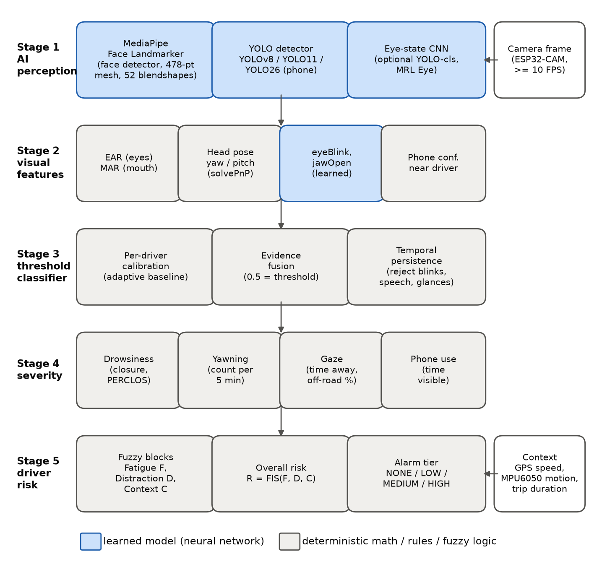
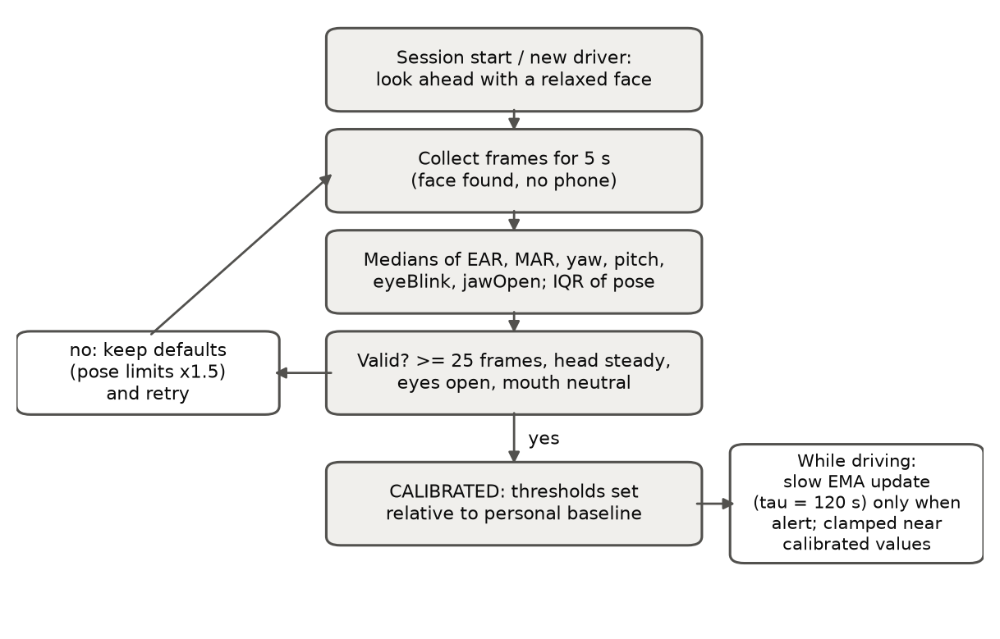
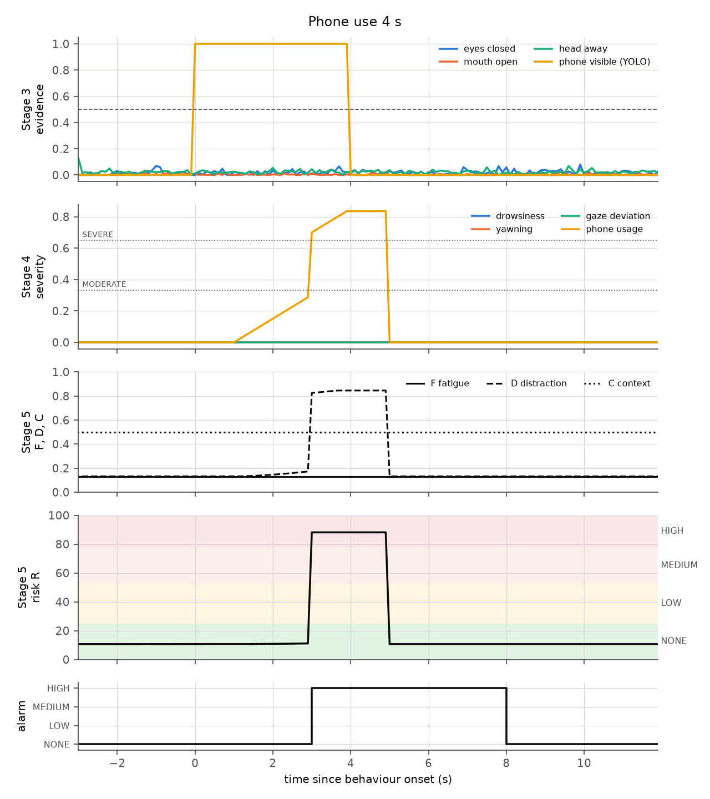
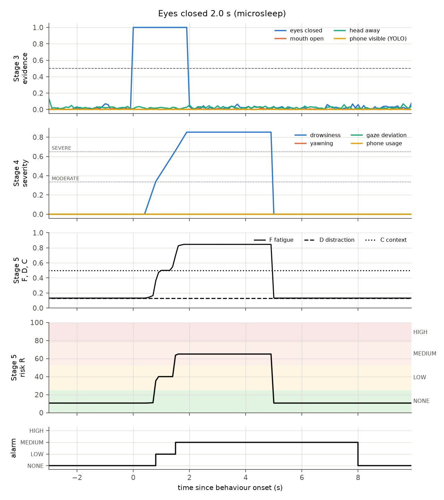

# Chapter 4 DESIGN CONSIDERATIONS

This chapter presents the design of the detection model: the requirements it must satisfy, the decisions taken at each of its five stages, the alternatives considered, the parameters chosen and why, and the procedures that will verify the design. It also presents the experimental design for comparing YOLOv8, YOLO11 and YOLO26 for Android deployment. The design follows the principle established in Chapter 3: **learned models perceive, and transparent rules interpret what they perceive.**

The reference implementation (version 1) is a Python package that runs on a laptop, which is used as a stand-in for the phone. It takes video from a webcam, a recorded file or the ESP32-CAM stream. All of its parameters are gathered in one configuration file (`configs/default.yaml`), and every design claim in this chapter is checked by an automated test. Section 4.10 describes how the same design carries over to the companion Android application.

---

## 4.1 Design Requirements

TABLE 4.1 lists the requirements that the objectives and performance targets of Chapter 1 place on the detection model.

TABLE 4.1 DESIGN REQUIREMENTS OF THE DETECTION MODEL

| ID | Requirement | Source | How the design addresses it |
|---|---|---|---|
| R1 | Detect drowsiness, yawning, gaze deviation and phone use | SO3 | Four behaviour channels (Sections 4.5–4.7) |
| R2 | F1 ≥ 0.85 (drowsiness, gaze) and ≥ 0.80 (yawning, phone) | SO3, Table 1.3 | Per-driver thresholds, evidence fusion, event-level evaluation (4.9) |
| R3 | Real-time processing at ≥ 10 FPS on the phone | SO1, SO4 | Mobile-first models; detector can skip frames; YOLO comparison (4.4) |
| R4 | Share of the ≤ 500 ms end-to-end latency: CV ≤ 40 ms, fuzzy ≤ 10 ms | SO2, Table 1.5 | Latency logged per stage; fuzzy stage measured at < 1 ms |
| R5 | Adapt to the individual driver instead of fixed thresholds | Section 1.7.9, PS2 | Calibration + online adaptation (4.5.2) |
| R6 | Three-tier alarm proportional to risk; ≤ 0.5 unnecessary alarms / h | SO5 | Fuzzy risk → tiers; persistence rules; hysteresis (4.7) |
| R7 | Use driving context (speed, motion, duration) | Sections 1.7.14–1.7.16 | Context fuzzy block (4.7) |
| R8 | Keep working without Internet; missing sensors must not silence alarms | Section 1.7.11 | All inference on-device; missing GPS treated as "moving" |
| R9 | Strengthen and make visible the AI component; do not rely on thresholds alone | Adviser | Three learned models + learned blendshapes; AI/rule separation (4.2); YOLO comparison (4.4); ablation (4.9.3) |
| R10 | Low cost; no subscription; data stays with the study | GO, Section 1.7.20 | Runs on the phone the driver already owns; logs stored locally |

---

## 4.2 Design Principle: AI Perception with Rule-Based Interpretation

Figure 4.1 shows the complete pipeline, organised as the chain suggested by the adviser:

**AI-based image detection → visual feature extraction → threshold-based classification → severity level → overall driver-risk calculation.**



*Figure 4.1 The five-stage detection pipeline. Blue blocks are learned models (neural networks); grey blocks are deterministic computations, rules or fuzzy logic that interpret the learned outputs.*

The design deliberately keeps the two kinds of reasoning apart.

* **What the AI decides.** Where the face is, where each of its 478 landmarks lies, how strongly the eyes are blinking and the jaw is open (blendshapes), whether and where a phone is present (YOLO), and optionally whether an eye crop looks closed (eye-state CNN). These are perception judgements learned from large labelled datasets.
* **What the rules decide.** Whether those measurements are *unusual for this particular driver* (calibrated thresholds), whether the unusual state lasted long enough to matter (persistence), how serious it is (severity), and how dangerous it is *in the current driving context* (fuzzy risk). These judgements must be transparent, tunable and explainable in a safety-related product, so they are expressed as rules rather than learned end to end.

This split has three practical benefits. First, each learned model can be replaced independently: a better phone detector or a trained eye-state model plugs in without changing the rules. Second, every alarm can be traced back to the measured evidence that caused it; the log records each stage for every frame. Third, the rules can be retuned from recorded data without retraining any network (Section 4.9.3).

TABLE 4.2 summarises the stages.

TABLE 4.2 STAGE-BY-STAGE DESIGN SUMMARY

| Stage | Input | Method | Type | Output | Code |
|---|---|---|---|---|---|
| 1 AI-based image detection | Camera frame | MediaPipe Face Landmarker; YOLO (v8/11/26); optional eye-state CNN | Learned | Landmarks, blendshapes, phone boxes, P(closed) | `dms/perception/` |
| 2 Visual feature extraction | Stage-1 outputs | EAR, MAR, solvePnP head pose, phone-near-driver filter | Deterministic | Feature vector per frame | `dms/features/` |
| 3 Threshold-based classification | Features + baseline | Calibrated thresholds, evidence fusion, temporal persistence | Rules + statistics | Per-frame states, behaviour events, PERCLOS etc. | `dms/classification/` |
| 4 Severity level | Stage-3 status | Anchor tables → score [0, 1] and level | Rules | Severity per behaviour | `dms/severity.py` |
| 5 Overall driver risk | Severities + context | Hierarchical Mamdani FIS; alert manager | Fuzzy rules | R (0–100), alarm tier, alarm commands | `dms/risk/`, `dms/alerts.py` |

---

## 4.3 Stage 1 — Face and Landmark Model

### 4.3.1 Alternatives

TABLE 4.3 compares the face-analysis options considered.

TABLE 4.3 FACE-ANALYSIS ALTERNATIVES

| Option | Output | Eye/lip detail for EAR/MAR | Learned expression scores | Android support | Notes |
|---|---|---|---|---|---|
| OpenCV Haar cascades (Viola & Jones, 2001) | Face/eye boxes | No landmarks | No | Yes | Detection only; sensitive to pose and lighting |
| dlib 68-point landmarks (Kazemi & Sullivan, 2014) | 68 2-D points | 6 per eye, 8 inner lip | No | Via native build | Used by Hernandez et al. (2024); no official mobile SDK |
| MTCNN (Zhang et al., 2016) | Box + 5 points | Too few points | No | Third-party | Cannot compute EAR/MAR |
| **MediaPipe Face Landmarker** | 478 3-D points + 52 blendshapes | Dense eyelid, lip and iris points | **Yes** | **Official Tasks SDK** | Same model file on laptop and phone |

MediaPipe Face Landmarker was selected. It is the only option that gives dense eyelid and lip landmarks together with learned blendshape scores. It is designed for real-time mobile inference, and the identical `face_landmarker.task` file runs in the Python prototype and in the Android Tasks SDK, so results measured in the prototype transfer to the app. The model runs in video mode with one face (the driver) and default confidence thresholds of 0.5. On the development computer, a cloud CPU with 4 threads, it took about 10 ms per frame. That figure is only a reference point; the phone measurement is the one that counts.

### 4.3.2 Learned Blendshapes as a Second Measurement

The `eyeBlinkLeft`, `eyeBlinkRight` and `jawOpen` blendshapes are used alongside EAR and MAR. This gives each facial state one geometric measurement (from learned landmarks) and one directly learned measurement. Section 4.5.3 explains how they are fused. Section 4.9.3 explains how their individual contributions are measured, so the benefit of the learned signals is demonstrated with data rather than assumed.

### 4.3.3 Optional Learned Eye-State Classifier

The MRL Eye Dataset contains eye crops and cannot be used to validate EAR (Section 3.6). The design therefore uses it for what it supports: training a small eye-state classifier. `scripts/prepare_mrl_eye.py` converts the dataset into open/closed folders and splits it *by subject*, so no person appears in both training and test data. `scripts/train_yolo.py --task classify` then trains YOLOv8n-cls, YOLO11n-cls and YOLO26n-cls with identical settings. At run time both eyes are cropped from the landmarks and converted to greyscale to match the infrared MRL images. The classifier's probability of "closed" becomes a third eye-closure evidence source (about 6 ms per frame on the development computer). The classifier is disabled by default and is enabled with `--eye-model <weights>`.

---

## 4.4 Stage 1 — Phone Detector and the YOLOv8 / YOLO11 / YOLO26 Comparison

### 4.4.1 Candidates

The adviser asked for YOLOv8, YOLO11 and YOLO26 to be compared for suitability on Android. All three are used in their **nano** size (`n`), the size intended for phones, and in their COCO-pretrained form they already contain a "cell phone" class. They share one software interface, so the detection model uses whichever weights file is supplied (`--yolo models/yolo26n.pt`). Everything else in the pipeline stays identical, which is what makes the comparison fair.

TABLE 4.4 lists the *static* properties of the three models as measured in this study. These are properties of the network files themselves, not performance results. A smaller parameter or FLOP count does not guarantee faster inference on a particular phone (Section 3.5.6), and it says nothing about accuracy on driver images. **No model is considered better until the tests below are run.**

TABLE 4.4 STATIC PROPERTIES OF THE CANDIDATE DETECTORS (MEASURED, NOT PERFORMANCE RESULTS)

| Model | Parameters | GFLOPs @320 | GFLOPs @640 | `.pt` file | ONNX FP32 @640 | NMS needed |
|---|---|---|---|---|---|---|
| YOLOv8n | 3.16 M | 2.21 | 8.86 | 6.5 MB | 12.9 MB | Yes |
| YOLO11n | 2.62 M | 1.66 | 6.67 | 5.6 MB | 10.7 MB | Yes |
| YOLO26n | 2.57 M | 1.54 | 6.24 | 5.5 MB | 9.9 MB | No (end-to-end) |

*The `.pt` files store half-precision weights; FP32 exports are therefore about twice as large. FP16 and INT8 exports shrink them again.*

### 4.4.2 Experimental Design

**Research question.** Which of YOLOv8n, YOLO11n and YOLO26n best satisfies the phone-use detection requirement (F1 ≥ 0.80) together with the real-time requirement (≥ 10 FPS for the whole pipeline) on the team's Android phone?

**Independent variable.** Detector generation (YOLOv8, YOLO11, YOLO26). Secondary factors are input size (320 and 640) and export format/precision (TFLite FP32, FP16, INT8; NCNN).

**Controlled variables.** TABLE 4.5 lists what is held constant.

TABLE 4.5 CONTROLLED VARIABLES OF THE COMPARISON

| Variable | Setting |
|---|---|
| Model size | nano (`n`) for all three |
| Training data and split | Same dataset, same subject-wise train/val/test split |
| Training hyper-parameters | Same epochs (100), image size, batch (16), patience (20), seed (0), deterministic mode (`train_yolo.py`) |
| Evaluation data | Same held-out test split; same evaluator for all models (`benchmark_yolo.py`) |
| Confidence / IoU thresholds | 0.35 confidence (deployment value), IoU 0.5 for matching and NMS |
| Hardware and software | Same computer and same phone, same runtime versions, same number of threads, same delegate |
| Measurement procedure | Warm-up runs discarded; 100 timed runs; median and p95 reported |

**Dependent variables (metrics).** TABLE 4.6 lists what is measured and how.

TABLE 4.6 METRICS FOR THE DETECTOR COMPARISON

| Metric | Why it matters for Android | How it is measured |
|---|---|---|
| Precision, recall, F1 at conf 0.35 | SO3 target for phone use (F1 ≥ 0.80) | `benchmark_yolo.py --data` (box-level, IoU ≥ 0.5) |
| Image-level phone presence P/R/F1 | What the behaviour channel actually uses | same script |
| AP@0.5 | Threshold-independent accuracy | same script (validated against the Ultralytics validator: AP within 0.01 on COCO classes with many instances) |
| Latency: pre-processing + inference + post-processing (incl. NMS), median and p95 | Real-time requirement; includes the NMS cost that NMS-free YOLO26 avoids | desktop: `benchmark_yolo.py`; phone: protocol 4.4.4 |
| FPS | ≥ 10 FPS target | 1000 / median total latency |
| Model size on disk per format | App size, download, memory | file size of each export |
| Parameters, GFLOPs | Computational requirement | Ultralytics profiler |
| Peak memory, thermal throttling, battery drain | Sustained use in a car | phone protocol 4.4.4 |

### 4.4.3 Training Data

The State Farm and AUC distracted-driver datasets contain image-level class labels only (c0–c9), with no bounding boxes. A detector needs boxes. The design therefore uses **pseudo-labelling with human verification**:

1. `scripts/autolabel_phones.py` passes every image from the phone classes (texting or calling, either hand) through a large pretrained "teacher" detector (e.g. YOLO11x) and writes its phone boxes as labels. Safe-driving images are added as negatives with empty labels, and phone-class images in which the teacher found nothing are listed for review.
2. The split is done **by driver** (State Farm's `driver_imgs_list.csv`), so the same person never appears in both training and test data.
3. A team member reviews and corrects the labels in a labelling tool (CVAT, Label Studio or Roboflow) **before** the test split is used to report results. Otherwise the evaluation would only measure agreement with the teacher model.
4. Because those datasets are photographed from the passenger side, a set of **ESP32-CAM images from the windshield position** (team members enacting phone use, with consent) is labelled and used as the final test set. This measures accuracy in the deployment domain (Section 3.5.5).

### 4.4.4 Measurement Protocols

**Desktop (reproducible, every model and format).**

```bash
python scripts/benchmark_yolo.py \
    --models runs/detect/yolov8n/weights/best.pt runs/detect/yolo11n/weights/best.pt runs/detect/yolo26n/weights/best.pt \
    --data datasets/phone/data.yaml --split test --imgsz 320 640 --formats pytorch onnx ncnn tflite_fp16 tflite_int8
```

The script writes `results.csv`, `results.md` and `results.json`, including the software versions and the CPU used. Desktop latency is a proxy only: it ranks the models on a CPU but does not predict phone timings.

**On the Android phone (for the final decision).**

1. Export each fine-tuned model to TFLite FP32, FP16 and INT8, and to NCNN (the export step is included in the script above).
2. *Inference-only timing:* run the TensorFlow Lite `benchmark_model` tool over ADB (for example `--num_threads=4 --use_gpu=true --warmup_runs=10 --num_runs=100`), and `benchncnn` for NCNN models. Record the average and standard deviation of inference time and the reported peak memory.
3. *End-to-end timing in the app:* time pre-processing, inference and post-processing (including NMS where needed) in the Android app on live ESP32-CAM frames. Run for 5 minutes after a 1-minute warm-up and record the median, p95 and FPS.
4. *Sustained use:* run the whole pipeline for 30 minutes and record the battery-level change and any thermal throttling (FPS in the last 5 minutes compared with the first 5).
5. Repeat each measurement three times and report the median of the three runs, together with the phone model, SoC, Android version, thread count and delegate.

### 4.4.5 Decision Rule, Declared Before Testing

To avoid choosing the criteria after seeing the results, the selection rule is fixed now:

1. **Gate.** A model/format is eligible only if its phone-use F1 on the ESP32-CAM test set is ≥ 0.80 **and** the complete pipeline runs at ≥ 10 FPS (median) on the team's phone.
2. **Rank.** Among eligible candidates, choose the highest F1.
3. **Tie-break.** If the F1 scores differ by less than 0.02, choose the one with the lower median end-to-end latency. If those differ by less than 10 %, choose the smaller file.
4. If no candidate passes the gate, report this as a finding. Then apply the mitigations of Section 4.4.6 and repeat.

TABLE 4.7 is the results template to be filled in after testing.

TABLE 4.7 DETECTOR COMPARISON RESULTS (TO BE COMPLETED AFTER TESTING)

| Model | Format | imgsz | Size (MB) | P | R | F1 | AP50 | Desktop median (ms) | Phone median (ms) | Phone p95 (ms) | Pipeline FPS (phone) | Passes gate |
|---|---|---|---|---|---|---|---|---|---|---|---|---|
| YOLOv8n | TFLite FP16 | 320 | | | | | | | | | | |
| YOLO11n | TFLite FP16 | 320 | | | | | | | | | | |
| YOLO26n | TFLite FP16 | 320 | | | | | | | | | | |
| … | … | … | | | | | | | | | | |

### 4.4.6 Latency Considerations for the Detector

The latency budget of Table 1.5 allocates ≤ 40 ms to "MediaPipe + OpenCV" but lists no time for the YOLO detector. On the development computer, the face model took about 10 ms per frame and the YOLO detector about 40 ms at 640 × 640. The detector is therefore the most expensive part of the pipeline, and Table 1.5 should be revised to include it. The design provides three measures that keep the pipeline within budget without weakening detection:

* **Smaller input size** (`--imgsz 320`): about one quarter of the FLOPs of 640 (TABLE 4.4). Its effect on accuracy is measured in the comparison.
* **Running the detector on every *N*-th frame** (`--yolo-every N`). Phone use must persist for 3 s before it is confirmed, so running YOLO at 5 FPS (every second frame of a 10 FPS stream) still yields about 15 observations per confirmation window. Boxes are reused in between.
* **NMS-free inference** (YOLO26), which removes the post-processing step; its actual benefit is measured, not assumed.

---

## 4.5 Stages 2 and 3 — Features and Threshold-Based Classification

### 4.5.1 Feature Extraction Design

TABLE 4.8 lists the landmark indices of the MediaPipe mesh that are used.

TABLE 4.8 LANDMARKS USED BY THE FEATURE EXTRACTOR

| Feature | Landmarks (MediaPipe indices) |
|---|---|
| EAR, subject's right eye (p1…p6) | 33, 160, 158, 133, 153, 144 |
| EAR, subject's left eye (p1…p6) | 362, 385, 387, 263, 373, 380 |
| MAR, inner lips (q1…q8) | 78, 81, 13, 311, 308, 402, 14, 178 |
| Head pose (solvePnP) | 1 nose tip, 152 chin, 33 / 263 outer eye corners, 61 / 291 mouth corners |

The two EAR values are averaged. The camera intrinsics are approximated as focal length = image width with the principal point at the image centre; calibration against the driver's own forward pose absorbs the resulting bias. Head pose was checked by projecting the 3-D model at known angles and recovering them: the error was below 0.5° over ±40° yaw and ±25° pitch. On a real face photographed from the side, calibration recorded a baseline yaw of 28°. This is exactly the kind of mounting offset that an absolute threshold would misread as "looking away."

**Phone-near-driver filter.** A detected phone counts only if its centre lies within ±2.5 face-widths of the face centre, horizontally, and no higher than half a face-height above the face. This ignores phones on the passenger seat, on a dashboard mount at the edge of the frame, or held by a passenger. When no face is visible, every phone counts.

### 4.5.2 Per-Driver Calibration and Adaptation

Figure 4.2 shows the calibration procedure of Section 1.7.9 as implemented.



*Figure 4.2 Per-driver calibration: a 5-s window of forward-facing frames produces a robust baseline; invalid windows keep the population defaults (with 1.5 × wider head-pose limits, which is conservative) and calibration retries; after success the baseline adapts slowly while the driver is confidently alert.*

The calibration window is 5 s. A baseline is accepted only if all of the following hold:

* at least 25 usable frames (face found, no phone);
* the head is steady (IQR-based spread of yaw and pitch ≤ 5°);
* the eyes are open (median EAR ≥ 0.18);
* the mouth is neutral (median MAR ≤ 0.25, eyeBlink ≤ 0.5).

The online update (Equation 3.12, T = 120 s) runs only when all evidence scores are low, no behaviour episode is active, and no event has occurred in the last 10 s. The running baseline is clamped to ±20 % of the calibrated EAR, ±0.10 of MAR and ±10° of pose. Pressing *c* in the prototype, or starting a new session in the app, recalibrates for a new driver.

### 4.5.3 Thresholds and Evidence Fusion

TABLE 4.9 lists the per-driver thresholds and the reasoning behind each initial value. They are **starting values**. Section 4.9.3 describes how they are tuned on labelled recordings using a tuning split that is kept separate from the final test data.

TABLE 4.9 PER-DRIVER THRESHOLDS (RELATIVE TO THE CALIBRATED BASELINE)

| Parameter | Value | Rationale |
|---|---|---|
| Eyes closed: EAR < r × baseline | r = 0.70 | Fixed thresholds of 0.18–0.25 against open-eye EAR ≈ 0.25–0.30 (Dewi et al., 2022; Maheswari et al., 2022) correspond to ratios of ≈ 0.6–0.8; 0.70 is the centre of that range, applied per driver |
| Eyes closed: eyeBlink > baseline + Δ | Δ = 0.35 | Open-eye eyeBlink measured ≈ 0.10–0.15 → threshold ≈ 0.5, the midpoint of the blendshape scale |
| Mouth wide open: MAR > baseline + Δ | Δ = 0.40 | Closed-mouth MAR ≈ 0.01; speech keeps MAR well below a yawn; to be verified on YawDD |
| Mouth wide open: jawOpen > baseline + Δ | Δ = 0.35 | Same reasoning on the learned scale |
| Head turned away: \|yaw − baseline\| > | 30° | Beyond the normal forward scanning range; mirror checks are rejected by duration, not angle |
| Looking down: pitch < baseline − | 20° | Lap/phone glances; looking up uses 25° |
| Decision level (fused evidence) | 0.5 | By construction of Equation 3.9 (0.5 = at threshold) |
| Pose limits while uncalibrated | × 1.5 | Conservative: fewer false gaze alarms before a baseline exists |

**Evidence fusion.** The eye-closure evidence is the weighted mean (Equation 3.10) of the EAR, eyeBlink and eye-state-CNN evidence, with weights 0.5 / 0.5 / 0.5. The mouth evidence combines MAR and jawOpen (0.5 / 0.5). Head-pose evidence is the largest of the yaw, pitch-down and pitch-up evidence. Two rules prevent known confusions:

* **Eye state is not judged while the head is turned away or the mouth is wide open.** EAR falls when the head is lowered, and the eyes squint during a yawn. Such frames are treated as "not observable" for the eyes rather than as closed, and they are excluded from PERCLOS.
* **Face loss counts as looking away** for up to 10 s. A face that disappears mid-drive usually means the head has turned beyond the range of the landmark model. After 10 s the system reports *no face / monitoring degraded* instead, consistent with the delimitation that full absence of the driver is outside the system's detection capability.

### 4.5.4 Temporal Persistence

TABLE 4.10 lists the persistence rules. All durations are in seconds (Section 3.10.5).

TABLE 4.10 TEMPORAL PERSISTENCE PARAMETERS

| Rule | Value | Rejects / captures | Basis |
|---|---|---|---|
| Eye-closure event | ≥ 0.5 s | Rejects ordinary blinks | Caffier et al. (2003); Wu & Chang (2022) |
| PERCLOS window | 60 s (valid after 30 s of data) | Sustained eyelid drooping | Wierwille et al. (1994); Dinges & Grace (1998) |
| Yawn | Mouth wide open ≥ 1.5 s | Rejects speech and singing | Section 3.10.3 |
| Yawn count window | 5 min | "Frequent yawning" | Table 1.11 |
| Gaze deviation event | ≥ 2.0 s continuous | Rejects mirror and shoulder checks | NHTSA (2013); Klauer et al. (2006) |
| Eyes-off-road share | 30 s window | Repeated short glances (texting pattern) | NHTSA (2013) 12-s total guideline |
| Phone use | Visible ≥ 3.0 s | Rejects momentary appearance | Section 1.7.15 |
| Gap tolerance | 0.15 s eyes, 0.3 s mouth/gaze, 0.5 s phone | A single missed detection does not reset an episode | Design choice |

The PERCLOS coverage requirement (30 s) was raised from an initial 15 s after the stage-by-stage plot of a single microsleep showed an artefact. With only 15 s of data, one 2-s closure produced a PERCLOS of 13 %, and a second, spurious fatigue alarm followed. Each microsleep is already caught at once by the closure-duration rule.

---

## 4.6 Stage 4 — Severity Levels

Each behaviour receives a severity *score* in [0, 1], which is the crisp input of the fuzzy system. For explanation it also receives a *level*: NONE, MILD, MODERATE or SEVERE. The score comes from a piecewise-linear table. The key design decision is where the table places the scores **1/3** and **0.65**. These are the crossover points of the fuzzy sets (Equation 3.15), where the dominant term changes from Low to Moderate and from Moderate to High, and where the resulting alarm tier changes. Anchoring the tables at those points makes the severity levels, the fuzzy inputs and the alarm tiers agree with each other and with the persistence limits in TABLE 4.10.

This alignment was reached through testing. With the first version of the tables, looking away triggered the MEDIUM tier after 1.7 s instead of the intended 2.0 s. The cause was that the fuzzy crossover (1/3), not the table value 0.5, decides the tier change. After re-anchoring, the onset table (generated from the code) matches the intended limits exactly.

TABLE 4.11 SEVERITY ANCHOR TABLES (0.34 → MODERATE, 0.66 → SEVERE)

| Behaviour | Measured quantity | Anchors (quantity → score) |
|---|---|---|
| Drowsiness | Longest eye closure in the last 3 s | 0.4 s → 0, **0.8 s → 0.34**, **1.5 s → 0.66**, 2 s → 0.9, 3 s → 1 |
| Drowsiness | PERCLOS (60 s) | 4 % → 0, **8 % → 0.34**, **15 % → 0.66**, 25 % → 1 |
| Yawning | Yawns in 5 min | 1 → 0.40, 2 → 0.50, **3 → 0.70**, 4 → 0.9 |
| Gaze deviation | Continuous time looking away | 1 s → 0, **2 s → 0.34**, **3 s → 0.66**, 4 s → 0.9, 5 s → 1 |
| Gaze deviation | Eyes-off-road share (30 s) | 10 % → 0, **25 % → 0.34**, **40 % → 0.66**, 60 % → 1 |
| Phone use | Continuous time visible | 1 s → 0, 2.99 s → 0.30, **3.0 s → 0.70**, 5 s → 1 |

Drowsiness takes the larger of its closure and PERCLOS scores, and gaze deviation the larger of its two scores. A behaviour is counted as *detected* for evaluation (SO3) as follows: drowsiness when its severity reaches MODERATE; yawning during a confirmed yawn; gaze deviation during a confirmed episode of ≥ 2 s; phone use during a confirmed episode of ≥ 3 s.

---

## 4.7 Stage 5 — Overall Driver-Risk Calculation and Alarms

### 4.7.1 Fuzzy Variables

All intermediate variables (the four severities, speed, motion, duration, and F, D, C) use the Low/Moderate/High sets of Table 1.7 on [0, 1] (Figure 3.3a). Context inputs are first normalised:

* **Speed.** Below about 10 km/h the vehicle counts as stopped (Low); 20–60 km/h is normal driving (Moderate); 80 km/h and above is High. Testing takes place on private roads at roughly 20–40 km/h, so those speeds must count as normal driving, not as stopped. If GPS speed is missing, 40 km/h is assumed, so the loss of a sensor can never suppress an alarm (R8).
* **Erratic motion.** Peak horizontal acceleration from the MPU6050, computed on the ESP32 with gravity removed: Moderate from 0.25 g, High from 0.45 g (harsh braking or swerving).
* **Driving duration.** Moderate from 1 h, High from 2 h of continuous driving.

The overall risk R uses four output sets on 0–100, named after the alarm tiers of SO5 (Figure 3.3b). Table 1.9 and Figure 1.7 of Chapter 1 use the labels Moderate, High and Critical, while SO5 speaks of low-, medium- and high-risk alarms. This design uses **NONE, LOW, MEDIUM and HIGH** throughout so that one vocabulary covers both. The tier bounds (R = 25, 52.5, 77.5) lie midway between the centroids of neighbouring output sets.

### 4.7.2 Rule Bases

Each rule base is generated from a short principle, which guarantees that every input combination has exactly one rule. The full tables are in the appendix (`Appendix_Rule_Tables.md`).

* **Fatigue (27 rules).** F is the stronger of eye closure and yawning. A long drive (duration High) escalates Moderate fatigue to High. Duration alone never raises fatigue.
* **Distraction (9 rules).** D is the stronger of gaze deviation and phone use; both Moderate together give High.
* **Context (9 rules).** Erratic motion dominates. Speed alone can raise C only to Moderate, because an alert driver at speed is not an alarm. Moderate motion at High speed gives High.
* **Overall (27 rules).** TABLE 4.12 gives the driver-state risk for normal driving context. Context then modifies it: Low context (stopped) lowers the result by one tier; High context (sudden or erratic motion) gives HIGH, as required by Section 1.7.1.

TABLE 4.12 OVERALL RISK FOR NORMAL DRIVING CONTEXT (C = MODERATE)

| Fatigue \ Distraction | Low | Moderate | High |
|---|---|---|---|
| **Low** | NONE | MEDIUM | HIGH |
| **Moderate** | LOW | MEDIUM | HIGH |
| **High** | MEDIUM | HIGH | HIGH |

The table encodes the behaviour-to-alarm mapping of Section 1.7.1: a single yawn is low risk; frequent yawning or drowsiness is medium risk; distraction is high risk. Fatigue and distraction together compound.

### 4.7.3 Resulting Behaviour-to-Alarm Onsets

TABLE 4.13 was generated by passing each behaviour, on its own, through Stages 4 and 5 (speed 40 km/h, start of trip). It is the most compact statement of what the designed system does.

TABLE 4.13 BEHAVIOUR-TO-ALARM ONSET (SINGLE BEHAVIOUR, NORMAL DRIVING)

| Behaviour (alone) | LOW tier from | MEDIUM tier from | HIGH tier from |
|---|---|---|---|
| Eye closure (continuous) | 0.8 s | 1.5 s | – |
| PERCLOS (60 s window) | 8 % | 15 % | – |
| Yawns in 5 min | 1 | 3 | – |
| Looking away (continuous) | – | 2.0 s | 3.0 s |
| Eyes-off-road share (30 s) | – | 25 % | 40 % |
| Phone visible (continuous) | – | – | 3.0 s |
| Erratic motion (alert driver) | – | – | 0.45 g |

### 4.7.4 Alarm Policy

The alert manager turns the tier into buzzer and notification commands. It limits alarm fatigue in three ways: it releases alarms only after hysteresis, it caps repetitions, and it rate-limits push notifications.

TABLE 4.14 ALARM POLICY

| Tier | Action (SO5) | Repetition | Notes |
|---|---|---|---|
| LOW | Soft buzzer | Once on entry, and again for each new behaviour event (≥ 5 s apart) | e.g. every yawn beeps once |
| MEDIUM | Repeating buzzer | Every 2 s, in bursts of at most 5; a new event re-arms the burst | Prevents 5 minutes of buzzing after frequent yawning |
| HIGH | Repeated alarm + push notification | Alarm every 1 s while HIGH; at most one push per 60 s | Push only when online (Section 1.7.11) |
| All | Escalation is immediate | De-escalation only after the lower tier has lasted 3 s | Prevents on/off flicker |

Commands are sent to the ESP32 buzzer through an HTTP endpoint (`--alert-url`). Each alert episode is logged with its reason, so the rate of unnecessary alarms per hour can be computed (Section 4.9).

---

## 4.8 Verification of the Design

The decision logic (Stages 3–5) was verified with synthetic drivers whose feature values mimic the real models' outputs. For example, open-eye EAR ≈ 0.29 and closed-mouth MAR ≈ 0.02 were measured on a real face. Every scenario starts with 8 s of alert driving, during which calibration completes. TABLE 4.15 shows the results. They are reproduced by `python scripts/simulate_scenarios.py` and enforced by the automated tests.

TABLE 4.15 SCENARIO VERIFICATION (TIME AFTER BEHAVIOUR ONSET)

| Scenario | Highest tier | Alarms |
|---|---|---|
| Alert driver, 2 minutes | NONE | – |
| Normal blinking | NONE | – |
| Talking for 30 s | NONE | – |
| Eyes closed 0.6 s (long blink) | NONE | – |
| Mirror glance 1.5 s | NONE | – |
| Phone visible 2.5 s | NONE | – |
| One yawn | LOW | +1.5 s LOW |
| Three yawns in about 70 s | MEDIUM | LOW, LOW, then MEDIUM burst on the third yawn |
| Eyes closed 1.0 s | LOW | +0.8 s LOW |
| Eyes closed 2.0 s (microsleep) | MEDIUM | +0.8 s LOW, +1.5 s MEDIUM |
| Looking away 2.5 s | MEDIUM | +2.0 s MEDIUM |
| Looking away 4 s / looking down 4 s | HIGH | +2.0 s MEDIUM, +3.0 s HIGH + push |
| Face lost 4 s (head turned far away) | HIGH | +2.0 s MEDIUM, +3.0 s HIGH + push |
| Phone use 4 s | HIGH | +3.0 s HIGH + push |
| Phone use 4 s, vehicle stopped | MEDIUM | +3.0 s MEDIUM (context lowers the tier) |
| Harsh braking 0.5 g, alert driver | HIGH | +0.0 s HIGH + push |

Figure 4.3 traces one scenario through all stages. YOLO evidence of the phone appears at once (Stage 3). Phone-use severity climbs slowly, then jumps past the SEVERE line at the 3-s confirmation (Stage 4). D rises, R enters the HIGH band, and the alarm is released 3 s after the phone disappears (Stage 5).



*Figure 4.3 Stage-by-stage response to 4 s of phone use (synthetic driver, 10 FPS).*



*Figure 4.4 Stage-by-stage response to a 2-s eye closure: soft buzzer at 0.8 s, repeating buzzer at 1.5 s, release after the hold and hysteresis periods.*

**End-to-end check with the real models.** A test video was built from a real face photograph: 8 s of the face, 3.5 s with the face absent, then the face again. The complete pipeline, with the real MediaPipe and YOLO models, calibrated (EAR 0.275, MAR 0.007), raised no alarm while the face was visible, and escalated to HIGH during the absence. On the development computer the whole pipeline processed about 14–18 frames per second. The decision stages (3–5) took about 0.5 ms per frame, far inside the 10 ms fuzzy-inference budget of Table 1.5.

**Test suite.** 61 automated tests check, among other things, that the formulas of Chapter 3 are implemented correctly and that the fuzzification and firing strengths of Tables 1.8 and 1.9 are reproduced exactly. They also check that the rule bases are complete, that head pose is recovered from known rotations, that calibration adapts to narrow eyes and rejects an unsteady head, that the persistence rules are independent of frame rate, that every scenario of TABLE 4.15 behaves as shown, and that the metric code used for the thesis numbers is correct.

---

## 4.9 Evaluation Design for the Detection Model

### 4.9.1 Data

TABLE 4.16 EVALUATION DATA

| Behaviour | Development / tuning data | Final test data |
|---|---|---|
| Yawning | YawDD videos (Abtahi et al., 2014), labelled into segments | ESP32-CAM recordings; field test |
| Drowsiness | Enacted eye closures (ESP32-CAM); optional eye-state CNN trained on MRL Eye | Field test with KSS self-ratings and annotator labels (Table 1.11) |
| Gaze deviation | SynDD1 (Rahman et al., 2023) gaze-zone videos; enacted glances | Field test |
| Phone use | Verified State Farm/AUC pseudo-labels (detector training) | ESP32-CAM recordings (detector); field test (behaviour) |

### 4.9.2 Procedure and Metrics

1. Record a session: `python scripts/run_monitor.py --source <video or ESP32 URL> --session-name S01`. The log stores every frame's features, states, severities, risk, context and timings.
2. Annotators label behaviour segments in a CSV file (`behavior,start_s,end_s`).
3. Score the session: `python scripts/evaluate_behaviors.py --session results/sessions/S01 --labels labels/S01.csv`. This reports frame-level and event-level precision, recall and F1 per behaviour, the median detection delay, and unnecessary alarms per driving hour.

The **event-level F1** is proposed as the primary SO3 figure. Frame-level scores are reported alongside it. The frame-level score is lowered by the confirmation delays that the design deliberately includes: in the end-to-end check, the gaze event was detected with event F1 = 1.00 but frame F1 = 0.50, because the first 2 s of the episode fall inside the persistence window. Reporting both, together with the detection delay, gives a complete picture.

### 4.9.3 Ablation Study: The Contribution of the Learned Signals

To show with data what the AI components contribute, and to answer the adviser's concern, the same recordings are re-scored with different evidence sources. The neural networks do not have to be re-run, because the logged Stage-2 features are replayed through Stages 3–5:

```bash
python scripts/evaluate_behaviors.py --session S01 --labels S01.csv --replay --eye-mode ear        --mouth-mode mar         # geometric only
python scripts/evaluate_behaviors.py --session S01 --labels S01.csv --replay --eye-mode blendshape --mouth-mode blendshape  # learned only
python scripts/evaluate_behaviors.py --session S01 --labels S01.csv --replay --eye-mode fused      --mouth-mode fused       # fused (default)
```

With a trained eye-state model, `--eye-mode cnn` adds a fourth variant. The same replay mechanism is used to **tune the thresholds** of TABLE 4.9 on a tuning split. The final numbers are then reported on sessions that were not used for tuning, which avoids overfitting the thresholds to the test data. The study does not state in advance which variant will perform best.

---

## 4.10 Software Design and Android Implementation Path

The prototype is organised so that each stage is a separate module with a typed interface (TABLE 4.2). Stages 3–5 are packaged as a `DecisionEngine` that has no dependency on the camera or the networks. TABLE 4.17 maps the prototype onto the companion Android application.

TABLE 4.17 MAPPING OF THE PROTOTYPE TO THE ANDROID APPLICATION

| Prototype component | Android counterpart |
|---|---|
| MediaPipe Face Landmarker (`face_landmarker.task`) | MediaPipe Tasks for Android `FaceLandmarker`, same model file, `LIVE_STREAM` mode |
| YOLO (`.pt`) | Exported TFLite/LiteRT or NCNN model chosen by the comparison (4.4.5), GPU delegate where supported |
| Eye-state CNN (optional) | Exported TFLite classifier |
| Stages 2–5 (Python, about 1,300 lines including comments; arithmetic only) | Kotlin port with no ML dependencies; parameters loaded from `default.yaml` exported to JSON |
| ESP32-CAM source, context and alert URLs | Same HTTP endpoints on the ESP32 |
| Session log (`frames.jsonl`, `alerts.jsonl`) | Local storage queue synced to Firebase (Section 1.7.11) |

**Parity testing.** The Kotlin port should be checked against the Python reference. Logged `frames.jsonl` files from real sessions are replayed through both implementations, and the per-frame tiers must match. This detects porting errors before any field test.

---

## 4.11 Issues Identified in the Proposal and Their Resolution

Implementing the model surfaced several points in Chapters 1–2 that should be updated for consistency. TABLE 4.18 lists them.

TABLE 4.18 PROPOSAL ITEMS TO RECONCILE

| # | Item in the proposal | Issue | Resolution in this design |
|---|---|---|---|
| 1 | Section 1.7.8: the YOLO detector is "the only trained model" | The face detector, face mesh and blendshape models are also trained neural networks | Describe Stage 1 as AI perception with three to four learned models (Section 4.2, TABLE 3.1) |
| 2 | Section 1.7.8: EAR validated on the MRL Eye Dataset | MRL contains eye crops only; EAR needs full-face landmarks | Use MRL to train the optional eye-state classifier; validate EAR on full-face video (YawDD, ESP32-CAM recordings) |
| 3 | Phone detector refined on State Farm / AUC | Image-level labels only (no boxes); passenger-side viewpoint | Pseudo-label, then human review; final test on ESP32-CAM images (4.4.3) |
| 4 | Table 1.5 latency budget | No allowance for YOLO inference, which is the most expensive stage | Add a detector line; use 320 input, frame skipping or an NMS-free model as measured (4.4.6) |
| 5 | Table 1.9 / Figure 1.7 labels (Moderate/High/Critical) versus SO5 (low/medium/high) | Two vocabularies for the same tiers | One vocabulary: NONE / LOW / MEDIUM / HIGH (4.7.1) |
| 6 | Speed context | Private-road test speeds (≈ 20–40 km/h) must not be treated as "stopped" | Speed normalisation keeps 20–60 km/h as normal driving (4.7.1) |
| 7 | Night testing (9 PM–12 AM) | The OV2640 sensor of the ESP32-CAM loses detail in low light; face and landmark detection degrade | Add infrared illumination (850 nm LEDs) with an IR-sensitive lens, or dim cabin lighting; report day and night results separately |
| 8 | Delimitation: absence of the driver from view | A head turned far away also makes the face disappear | Face loss counts as looking away for ≤ 10 s, then "monitoring degraded" (4.5.3) |

---

## 4.12 Design Trade-offs and Limitations

* **Rules versus end-to-end learning.** An end-to-end network could, in principle, learn drowsiness directly from video, but it would need large labelled on-road datasets and would be hard to explain or tune. The chosen design keeps learning where labelled data exist (faces, phones, eye state) and uses transparent rules where decisions must be explained. The cost is that rule parameters must be tuned, which the replay tooling makes practical.
* **Head pose instead of eye gaze.** Head pose is robust at low resolution but cannot see eyes-only glances (for example, looking down at a phone while keeping the head straight). The learned `eyeLookDown` blendshapes could cover this in a later version.
* **Speed escalation.** In version 1, speed lowers the risk only when the vehicle is stopped. A drowsy driver at 80 km/h receives the same tier as at 40 km/h. Adding speed escalation for fatigue and distraction is a candidate for version 2 once field data are available.
* **Synthetic verification.** The scenario tests prove that the logic behaves as designed. They do not prove detection accuracy on real drivers, which only the evaluation of Section 4.9 can establish.
* **Desktop timings.** All timings in this chapter come from a development computer and serve only to compare designs. Real-time compliance (≥ 10 FPS) must be confirmed on the phone.

---

## 4.13 Summary

The detection model is designed as a five-stage chain that separates AI perception from rule-based interpretation. MediaPipe's face detector, face mesh and blendshape networks, a swappable YOLO phone detector and an optional MRL-trained eye-state classifier supply learned measurements. Per-driver calibrated thresholds, temporal persistence, severity grading and a hierarchical 72-rule Mamdani system interpret those measurements in the context of speed, motion and trip duration, and the result drives a three-tier alarm with hysteresis. The thresholds are anchored to the fuzzy crossover points, so persistence limits, severity levels and alarm tiers agree with each other. This was verified by generated onset tables, scenario simulations, an end-to-end run with the real models and 61 automated tests. The comparison of YOLOv8, YOLO11 and YOLO26 has a fixed protocol, fixed metrics and a decision rule declared before any results. An ablation study will show the contribution of the learned signals. The next steps are to collect and label ESP32-CAM data, train and compare the detectors, tune the thresholds on a tuning split, port Stages 2–5 to the Android application and carry out the field test.

---

## References (sources added in this chapter)

*See also the reference list of Chapter 3. Please verify every entry before submission.*

Abtahi, S., Omidyeganeh, M., Shirmohammadi, S., & Hariri, B. (2014). YawDD: A yawning detection dataset. In *Proceedings of the 5th ACM Multimedia Systems Conference* (pp. 24–28). ACM.

Kazemi, V., & Sullivan, J. (2014). One millisecond face alignment with an ensemble of regression trees. In *Proceedings of the IEEE Conference on Computer Vision and Pattern Recognition* (pp. 1867–1874).

Rahman, M. S., Venkatachalapathy, A., Sharma, A., Wang, J., Gursoy, S. V., Anastasiu, D., & Wang, S. (2023). Synthetic distracted driving (SynDD1) dataset for analyzing distracted behaviors and various gaze zones of a driver. *Data in Brief, 46*, 108793.

Viola, P., & Jones, M. (2001). Rapid object detection using a boosted cascade of simple features. In *Proceedings of the IEEE Conference on Computer Vision and Pattern Recognition* (Vol. 1, pp. I-511–I-518).

Zhang, K., Zhang, Z., Li, Z., & Qiao, Y. (2016). Joint face detection and alignment using multitask cascaded convolutional networks. *IEEE Signal Processing Letters, 23*(10), 1499–1503.
